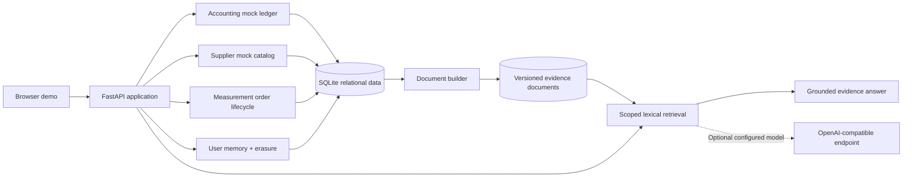

# FieldCraft — Engineering Systems Lab

An original, runnable portfolio project demonstrating five connected software-engineering workflows with a shared synthetic dataset.

> **Ownership and scope.** This repository is an independently written illustrative implementation. It does not contain an employer's source files, internal schemas, customer records, access credentials, UI assets, or vendor SDK secrets. The services below are intentionally not production connectors; the local accounting, supplier and measurement providers are simulated.

   

## Five working modules

| Demo | Capability | What it proves |
|---|---|---|
| 01 · Ledger Sync | Idempotent financial export/import against a mock ledger | Stable external IDs, synchronization state, optimistic concurrency and conflict handling |
| 02 · Supplier Import | Branch-specific catalog → validated material records | Account scoping, price/UOM validation, duplicate checks and partial success |
| 03 · Measurement Flow | Order state machine → structured measurement report | State transitions, report normalization, ingestion and project ownership |
| 04 · Document Pipeline | Relational records → versioned, retrieval-ready documents | Entity joins, source lineage, deterministic change detection and refresh |
| 05 · Context Pilot | Scoped evidence retrieval → traceable answers | Query routing, context carryover, source evidence, abstention and optional model generation |

A small **memory experiment** demonstrates explicit-write gates, provenance, valid-time updates and logical deletion of versions and tracked derivatives.

## Run locally

Requires Python 3.10+.

```bash
python -m venv .venv
source .venv/bin/activate  # Windows: .venv\Scripts\activate
python -m pip install -e '.[dev]'
uvicorn fieldcraft.api:app --app-dir src --host 127.0.0.1 --port 8000
```

Open **http://127.0.0.1:8000** for the interactive dashboard, or **http://127.0.0.1:8000/docs** for the generated API reference.

```bash
python -m pytest
PYTHONPATH=src python scripts/run_demo.py
python scripts/check_public_safe.py
```

Data is generated automatically in `data/fieldcraft.sqlite3` using invented workspaces, projects, transactions and materials. Delete the file to reset the demo. No API token is required.

## Suggested reviewer walkthrough (3 minutes)

1. Run **Ledger Sync** twice. The first run creates remote mappings; the second reports `unchanged`.
   Optionally import the mock incoming bill, or simulate a remote version conflict and sync again to see why reconciliation matters.
2. Search the **Supplier Catalog** and import items. Valid items are added, missing-price/unmapped-UOM items are skipped individually.
3. Request a **Measurement Report** and ingest the synthetic area/pitch/facet response.
4. Refresh **Document Pipeline**. The changed report/material records produce new document versions. A repeat refresh reports `unchanged`.
5. Ask **“Why did Cedar Residence exceed material cost?”**. Inspect the cost comparison, evidence IDs, routing and execution trace.
6. Try **Memory**: store a directly stated preference, recall it, then forget it. External content cannot author durable memory.

## Architecture



The document builder combines project and operational records, computes a content checksum and retains source IDs. A refresh only increments a version when the underlying document payload changes.

### AI mode is explicit

Out of the box, Context Pilot runs in **offline evidence mode**: deterministic structured answers or lexical matches, with citations and trace steps. It **does not** claim to use an LLM, embeddings, MongoDB or a vector database in that mode.

To experiment with a real model, set these server-side variables:

```bash
export LLM_BASE_URL="https://your-compatible-provider.example/v1"
export LLM_MODEL="your-model-id"
export LLM_API_KEY="your-key"
```

This enables optional OpenAI-compatible chat completion for grounded summaries. It does not add embedding retrieval automatically. Do not commit `.env` or secrets.

## Scope and limitations

- All financial, catalog, project, measurement and user-memory content is **synthetic**.
- The external provider surfaces are **simulations**, not authenticated commercial integrations. Availability means *available to order*, not physical stock quantity.
- The demo uses SQLite; an enterprise system could use relational databases, queues, documents and vector indexes. Those are future extensions, not shipped features of this repository.
- No authentication/authorization middleware is included. Workspace scoping illustrates backend data boundaries but **is not a production access-control system**. Run locally only.
- The memory experiment implements logical erasure in the relational store and its explicit derivatives. It does not promise erasure from filesystem snapshots, backups or other external processors.
- No customer or employer information should be added. Do not publish source files from private repositories.
- This code is for portfolio demonstration, architecture discussion and safe experimentation, not live accounting or purchasing.

## Documentation

- [Architecture and boundaries](docs/ARCHITECTURE.md)
- [Five engineering case studies](docs/CASE_STUDIES.md)
- [Review before publishing](docs/PUBLISHING_CHECKLIST.md)
- [Growth roadmap](docs/ROADMAP.md)
- [ETL walkthrough notebook](notebooks/etl_walkthrough.ipynb)

## Project layout

```text
src/fieldcraft/
  api.py                FastAPI endpoints and request models
  database.py           Scoped relational schema
  seed.py               Invented fixture records
  services/
    accounting.py       Idempotent two-way mock ledger sync
    supplier.py         Material validation and import
    measurement.py      Order lifecycle and report ingest
    etl.py              Relational-to-document transformation
  ai/
    retrieval.py        Transparent offline evidence matching
    provider.py         Optional model adapter
    assistant.py        Query routing and trace
    memory.py           Time-aware explicit memory / erasure
ui/                    Interactive HTML/CSS/JS dashboard
notebooks/             Independent pipeline walkthrough
tests/                 Test suite covering failure scenarios
scripts/               CLI demo and public-content checks
```

Use the README and case studies to discuss the problem, decisions, validation and trade-offs. Do not present this independent example as a deployed employer application.
