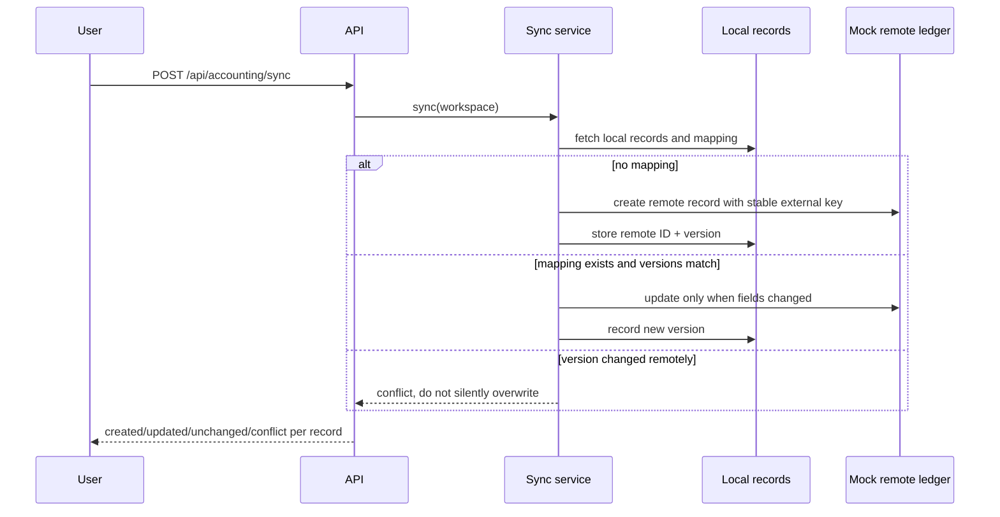

# Architecture and engineering decisions

## Objective

Illustrate how a product engineer can connect independent business capabilities around a coherent project model, while preserving identity, ownership, failure visibility and data provenance.

## Core entities

| Entity | Purpose | Isolation rule |
|---|---|---|
| Workspace | Owns projects, people and configuration | Every operation has a `tenant_id`; this is a demo-only boundary, not auth |
| Project | Business context for estimate, costs and measurements | Every selected project is verified against its workspace |
| Financial record | Structured cost/bill-like event | Stable local ID used for repeat-safe export |
| External mapping | Local↔remote identity and version | Uniqueness across workspace/provider/entity and local ID |
| Vendor / material | Imported catalog object with price and UOM | Vendor must belong to workspace; uniqueness for vendor+SKU |
| Measurement order | Ordered report with limited state transitions | A completed/cancelled order cannot be re-ingested |
| Evidence document | Versioned, query-ready project context | Scope by workspace; store source refs and checksum |
| Session | Current selected project for follow-up turns | Scope by workspace and demo user |
| Memory | Explicit user-stated fact with validity interval | No external/inferred writes; unique user scope on queries |

## Sequence: accounting sync

The simulated ledger persists separately from local records so optimistic concurrency is testable without real provider credentials.

## Sequence: supplier import

1. Select a configured workspace vendor and synthetic branch.
2. Query catalog items and account-like prices.
3. For each SKU: check availability-to-order, positive price, recognized supplier unit, tenant-enabled unit and existing vendor/SKU.
4. Add valid items to workspace materials; report every skipped item and reason.
5. Transform normalized material records into retrieval-ready project documents on next pipeline refresh.

## Sequence: measurement lifecycle

`requested` → `processing` → `completed`, or `requested/processing` → `cancelled`. A report can be ingested from `requested` or `processing` and moves the order to `completed` after validating area, pitch and facet count. This models lifecycle handling, not remote ordering or actual measurement extraction.

## Data pipeline

The pipeline derives documents from the current relational state. Documents include flattened context plus `source_refs_json`. It hashes a canonical payload before writing. Repeated refresh with unchanged input does not increment document versions. Workspace scope is applied before building any aggregate.

A production approach would add incremental change capture, source versioning, queues, object storage and re-embedding; these are not included here.

## Context Pilot

- Validate workspace and session ownership.
- Select an explicit project or carry forward a scoped project from the conversation.
- Route cost questions to a structured comparison, or other questions to evidence search.
- Return source document IDs and explicit steps used to produce the answer.
- When evidence is insufficient, abstain instead of generating a fabricated result.
- Optional real model response is clearly differentiated from offline evidence mode. Provider failures are reported, never disguised as a successful model answer.

## Memory demonstration

Writes are accepted only when they are explicitly user-authored and match a high-signal topic. New values close the prior valid-time interval. Historical queries look up which value was true at the requested time. Forgetting deletes every version of a topic and any registered derivative with `ON DELETE CASCADE`. This is logical deletion only; physical deletion across backups and processors requires a separate production policy.

## Security boundary

This is a local single-user demonstration with synthetic data and intentionally no authentication. It should never be treated as an internet-facing multi-tenant application. Adding real providers would require OAuth/secret storage, rotation, authorization, retry policies, rate limits, audit retention, data handling agreements and continuous testing.
